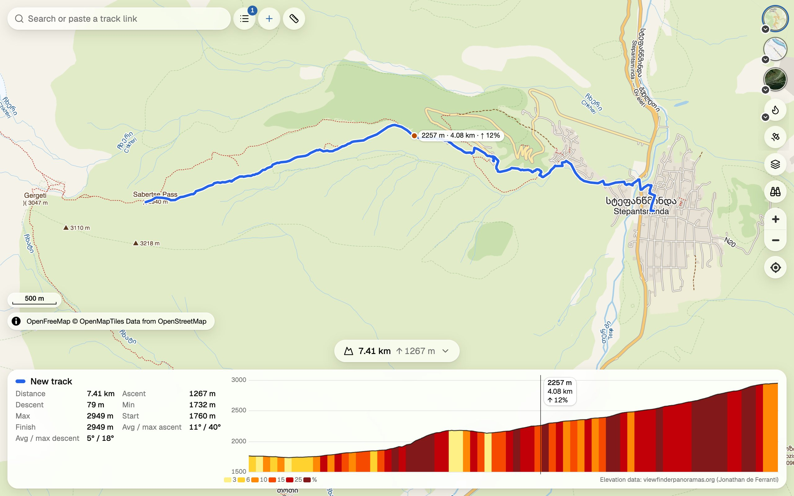

[](https://github.com/sergeycw/trailroutine/actions/workflows/check-web.yml)

# trailroutine

A free web map to plan outdoor routes: hiking, road bike, gravel, mountain bike and touring bike.

- Routes follow roads and trails. The [BRouter](https://github.com/abrensch/brouter) engine runs in your browser.
- Topographic maps, satellite imagery (also by date), Strava heatmap, contour lines and relief shading.
- Elevation profile with slope.
- Open GPX, KML, KMZ, GeoJSON and OziExplorer files. Save tracks as GPX with elevations or as KML.
- Share tracks with a link. No account.

Open it: https://trailroutine.com. The old address https://nakarte-routing.pages.dev moves visitors there with their saved tracks.



It started as a fork of [wladich/nakarte](https://github.com/wladich/nakarte), the code of nakarte.me by Sergey Orlov, and is developed as a separate product: the app in [web/](web/) is a rewrite on React and MapLibre that reads the old links. MIT license, see [LICENSE](LICENSE).

## Run locally

You need Node 22.12+ and Docker (BRouter runs in a container).

```bash
docker compose up -d
cd web
npm ci
npm run dev
```

The map opens at http://localhost:8769. Routing tiles and everything else about development are in [AGENTS.md](AGENTS.md).

## Docs

- [AGENTS.md](AGENTS.md): setup, environment, pitfalls and a map of the repository (in Russian).
- [docs/architecture/](docs/architecture/README.md): architecture diagrams from the system context down to each area, and a registry of technical decisions.
- [openspec/](openspec/): behaviour specs (`specs/`), plans and decisions (`changes/`), backlog (`backlog.md`). Older specs and decisions are in Russian, new ones are in English.
